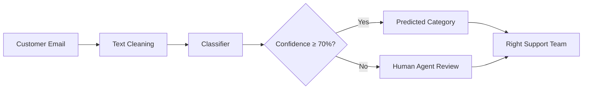

# SWYNEX-AI-Problem-Design

**Task 1 – AI Problem Design | SWYNEX Technologies Internship**
**Author:** Oumayma Bayar

---

## 1. Problem Statement

**Use case:** Binary text classification — automatically detect **spam SMS messages** (`spam` vs `ham`/legitimate) on a mobile phone or messaging gateway.

**Why this problem?**
SMS spam is a real, everyday problem: it wastes users' time, and a portion of it is phishing/fraud (fake prizes, fake bank alerts). The task is narrow, well-defined, and measurable, which makes it ideal for designing an AI solution end to end.

**One-sentence definition:**
> Given the raw text of an incoming SMS, predict whether it is `spam` or `ham`, so spam can be filtered before it reaches the user's inbox.

---

## 2. Target User

| User | Need |
|---|---|
| **Mobile user** | Inbox free of scams and junk, without losing real messages (OTP codes, friends, bank alerts). |
| **Telecom / app developer** | A lightweight, cheap-to-run filter that can be embedded in a messaging pipeline. |

**Critical user insight:** the two kinds of errors are *not* equally costly.

- **False negative** (spam reaches inbox) → annoying, sometimes risky (phishing).
- **False positive** (a real message is blocked) → **much worse** (missed OTP, missed message from family or bank).

So the system must be tuned to **protect legitimate messages first**.

---

## 3. Data Source

**Dataset:** SMS Spam Collection (UCI Machine Learning Repository)

- Page: https://archive.ics.uci.edu/dataset/228/sms+spam+collection
- Direct download: https://archive.ics.uci.edu/static/public/228/sms+spam+collection.zip
- Also on Hugging Face: https://huggingface.co/datasets/sms_spam
- Python shortcut: `pip install ucimlrepo` then `fetch_ucirepo(id=228)`
- **Local copy in this repo:** [`data/SMSSpamCollection`](data/SMSSpamCollection)

| Property | Value |
|---|---|
| Size | 5,574 English messages |
| Labels | `ham` = 4,827 (~86.6%), `spam` = 747 (~13.4%) |
| Format | One text file: `label <TAB> message` |
| Origin | Grumbletext forum, NUS SMS Corpus, a PhD thesis corpus, SMS Spam Corpus v0.1 |
| Citation | Almeida, Gómez Hidalgo & Yamakami (2011), *Contributions to the Study of SMS Spam Filtering*, ACM DocEng'11 |

It is small enough to run on a laptop in seconds, which fits the "small dataset" requirement of this task.

---

## 4. Constraints & Assumptions

**Technical**
- Small dataset (~5.5k rows) → favour simple, interpretable models over deep learning.
- **Class imbalance** (13% spam) → accuracy alone is misleading.
- Must be **fast and lightweight** (runs on-device or on a cheap server, milliseconds per message).

**Data limitations**
- English only; messages mostly from the UK and Singapore, collected around 2003–2012. Modern spam (crypto, delivery-scam links, other languages) is under-represented.
- Labels were made by humans and may contain some noise.

**Ethical / privacy**
- SMS is personal data. The dataset was published for research with volunteer consent; a production system should process messages locally or anonymise them and never store content unnecessarily.
- Blocking a legitimate message must be avoided, so a human-visible "Spam folder" is preferred over silent deletion.

**Out of scope**
- Multilingual spam, image/MMS spam, sender-reputation signals, and real-time retraining.

---

## 5. Success Criteria

Accuracy is **not** the main metric: a model that always predicts `ham` already scores ~86.6%.

| Metric | Target | Reason |
|---|---|---|
| **Spam recall** | ≥ 95% | Catch almost all spam. |
| **Spam precision** | ≥ 98% | Few legitimate messages wrongly blocked. |
| **False-positive rate (ham → spam)** | ≤ 1% | The costliest error for the user. |
| **F1 (spam class)** | ≥ 0.96 | Balanced summary of the two above. |
| **Inference latency** | < 50 ms / message | Usable in a live messaging flow. |

**Success** = all targets met on a held-out test set that the model never saw during training.

---

## 6. Evaluation Approach

1. **Split:** stratified 80% train / 20% test (`random_state=42`) so both sets keep the 13% spam ratio.
2. **Cross-validation:** 5-fold stratified CV on the training set to compare models fairly.
3. **Baselines (to prove the AI adds value):**
   - Baseline A – always predict `ham` (majority class).
   - Baseline B – simple keyword rules (e.g. "free", "win", "claim", "£", "txt").
4. **Candidate models:**
   - TF-IDF + **Multinomial Naive Bayes**
   - TF-IDF + **Logistic Regression** (`class_weight="balanced"`)
   - (Optional stretch) a small pretrained transformer for comparison.
5. **Metrics reported:** confusion matrix, precision, recall, F1 for the spam class, and ROC-AUC / PR-AUC.
6. **Threshold tuning:** choose the decision threshold that keeps the false-positive rate ≤ 1%, then report the resulting recall.
7. **Error analysis:** read the false positives and false negatives manually and describe patterns (e.g. short promo-like legit messages, spam without keywords).
8. **Decision rule:** the model is accepted only if it beats both baselines *and* meets the success criteria in section 5.

---

## 7. Proposed Solution Pipeline

```
Raw SMS → lowercase / clean → TF-IDF (word 1–2 grams) → Classifier → spam probability → threshold → Inbox / Spam folder
```

---

## 8. Risks & Mitigations

| Risk | Mitigation |
|---|---|
| Spam style changes over time (concept drift) | Re-evaluate periodically on fresh messages; keep a feedback button ("Not spam"). |
| Blocking legitimate OTP/bank messages | Strict threshold, spam goes to a folder instead of being deleted. |
| Small, dated dataset | Treat the result as a prototype; collect recent, local-language data before production. |
| Over-fitting to dataset quirks | Hold-out test set + cross-validation. |

---

## 9. Repository Structure

```
SWYNEX-AI-Problem-Design/
├── data/
│   └── SMSSpamCollection    # raw dataset (label <TAB> message)
└── README.md                # problem design document
```

---

## 10. Deliverables of This Task

- [x] Problem definition (this document)
- [x] User, data source, constraints
- [x] Success criteria and evaluation plan
- [ ] (Next tasks) Implementation, results and demo

---
## System Overview



*Submitted as part of the SWYNEX Technologies internship program. #SWYNEX #Internship*